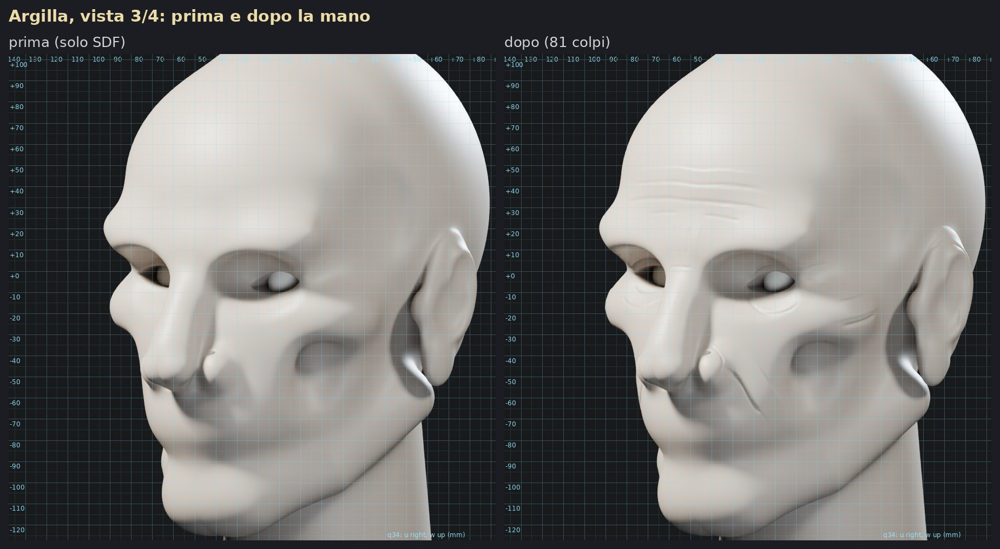
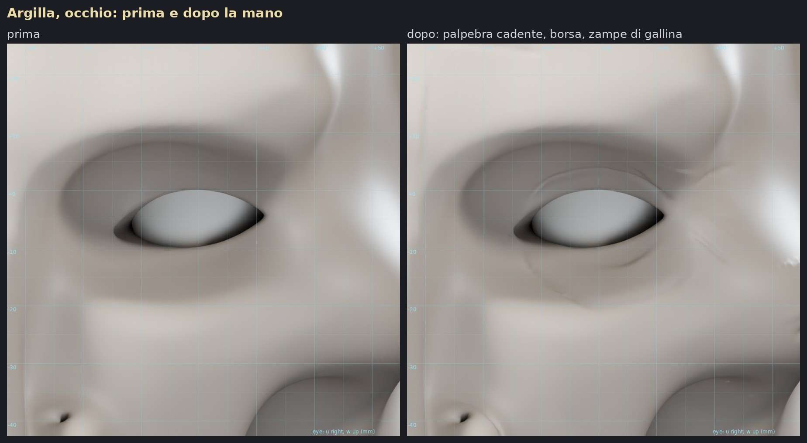
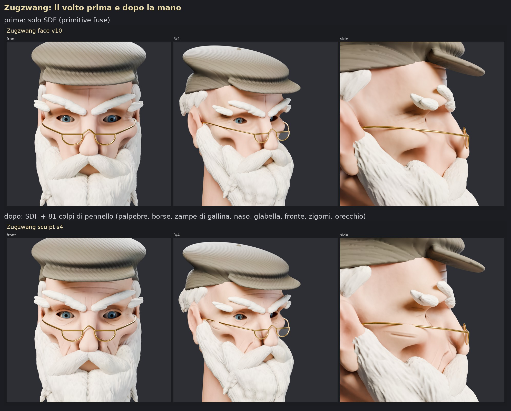
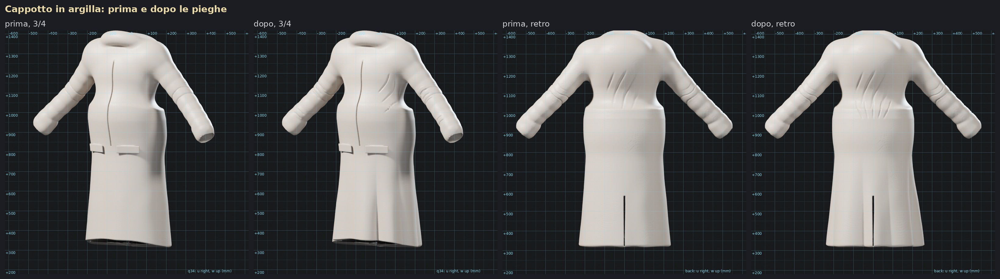
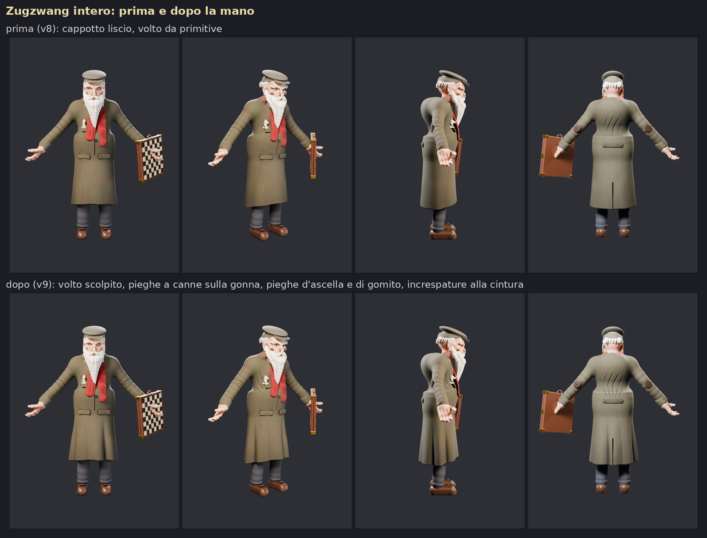

# La "mano": scolpire a colpi di pennello da codice

Le primitive fuse (SDF) danno le forme grandi. Quello che fa uno scultore dopo, cioè piani,
pieghe dell'età, rotoli di pelle e pieghe dei vestiti, mancava. In Blender headless i pennelli
di scultura non partono, perché vogliono una viewport (`sculpt.brush_stroke` rifiuta il
contesto). Così li ho riscritti: `charkit/sculpt.py` nella skill `blender-character`.

## Come funziona

- **Pennelli:** le formule sono quelle del sorgente di Blender 5.0 e i valori di partenza
  vengono dai preset di Blender 5.2. Ci sono crease, clay strips, clay, trim, flatten, fill,
  scrape, pinch, inflate, blob, draw, smooth, relax, grab e snake hook. Ogni colpo è una
  polilinea: le "pennellate" si posano ogni 0,06–0,2 raggi, con la pressione che sale e
  scende e la simmetria su X.
- **Come traccio:** renderizzo viste ortografiche in argilla con una griglia in millimetri e
  i punti di riferimento (occhi, naso, zigomo, orecchio), poi leggo le coordinate e scrivo il
  colpo su quella vista. Al momento di applicarlo, ogni punto viene proiettato sulla
  superficie attuale, come una penna appoggiata sulla creta.
- **La lista dei colpi è la scultura.** A ogni giro si riapplica da capo sulla mesh di base,
  quindi qualunque colpo si può spostare, indebolire o togliere dopo. Uno scultore umano
  questo non ce l'ha.
- **Ricette da scultore:** una ruga è fatta di cinque colpi (piega, relax, rotolo di pelle
  sopra, ammorbidimento sotto, lucidatura). La piega nasolabiale ha la massa della guancia
  che le cade sopra. Le pieghe "a canne" della gonna sono procedurali: creste tonde, valli
  strette, passo irregolare.

```bash
cd .claude/skills/blender-character/scripts/examples
python chess_master_sculpt.py --out <cartella> --stage base     # mesh + viste con griglia
python chess_master_sculpt.py --out <cartella> --stage sculpt   # riapplica i colpi
python chess_master_sculpt.py --out <cartella> --stage paint --parts <_parts del corpo>
python chess_master_folds.py  --parts <_parts del corpo> --out <cartella>   # cappotto
```

## Il test: Zugzwang

81 colpi sul volto, 4 giri di revisione:
- palpebra superiore cadente, borse e solco lacrimale, zampe di gallina;
- piani del naso e solco alare, rughe della glabella e della fronte;
- piega nasolabiale, zigomo, tempia piatta, guancia che cede;
- bordo dell'orecchio e antelice.

Sul cappotto: pieghe a canne sulla gonna, 29 colpi per ascelle, gomiti, polsini e cintura
dietro.







## Com'è andata, onestamente

- **In argilla il salto è netto.** Il volto passa da "plastica liscia" a una faccia vissuta,
  con età e struttura attorno agli occhi.
- **Nel colore il salto si attenua,** perché barba, baffi e cappello coprono metà della
  pelle. Anche il cappotto migliora meno: cambia soprattutto l'orlo e la gonna.
- **I primi tentativi hanno insegnato due cose, ora scritte nella skill:**
  - una piega più stretta di circa 3 lati di triangolo "strappa" la mesh: serve il relax
    dopo ogni piega;
  - un orecchio è una lamina sottile: scavando la conca l'ho bucato.
- **La mano è la parte facile.** Il collo di bottiglia è l'occhio: ogni giro di revisione
  (colpi più render) costa 7–10 minuti, e le coordinate le leggo da una griglia.
- **Supera la mano umana solo in parte.** La supera dove conta la precisione: simmetria
  esatta, ripetibilità, storia dei colpi modificabile, pieghe procedurali. Non la supera
  nel giudizio sulle forme grandi: le conche scavate dalle primitive restano, finché
  qualcuno non decide di rifarle.

## Prossimi passi possibili

Dal report di ricerca ([ricerca_modellazione.md](ricerca_modellazione.md)):
- adattare la forma di base alle schede Gemini con un renderer differenziabile su CPU
  (Mitsuba 3);
- far proporre al codice colpi candidati dalle mappe d'errore e sceglierli confrontando
  coppie di render;
- partire da mesh base con topologia già buona (Human Base Meshes CC0, MPFB).
