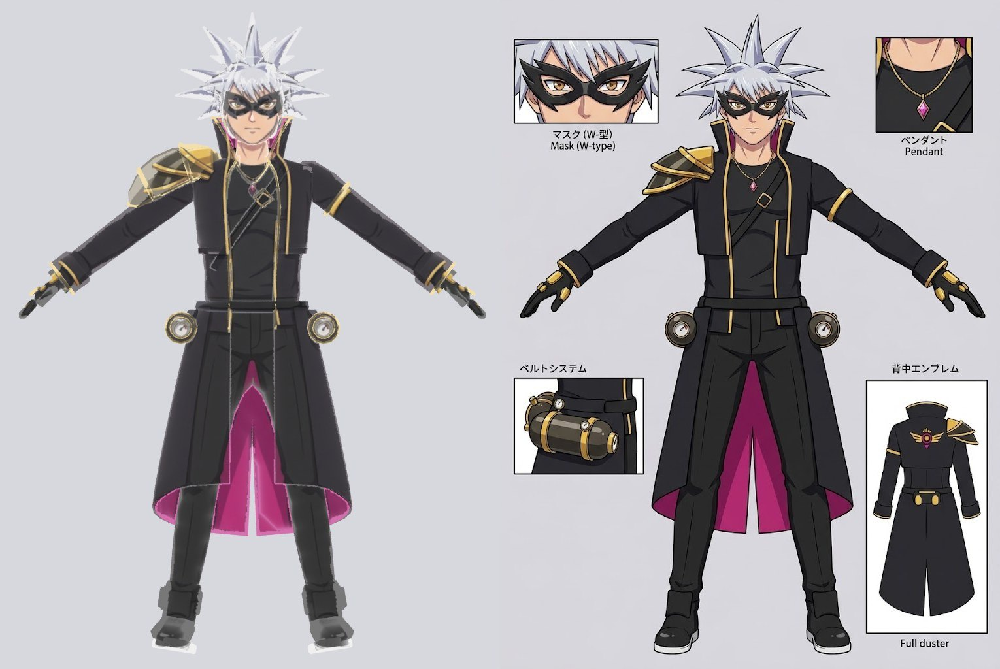
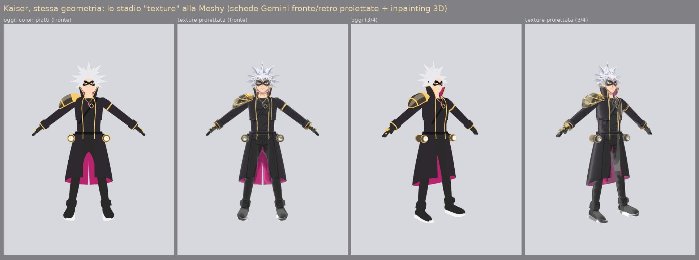
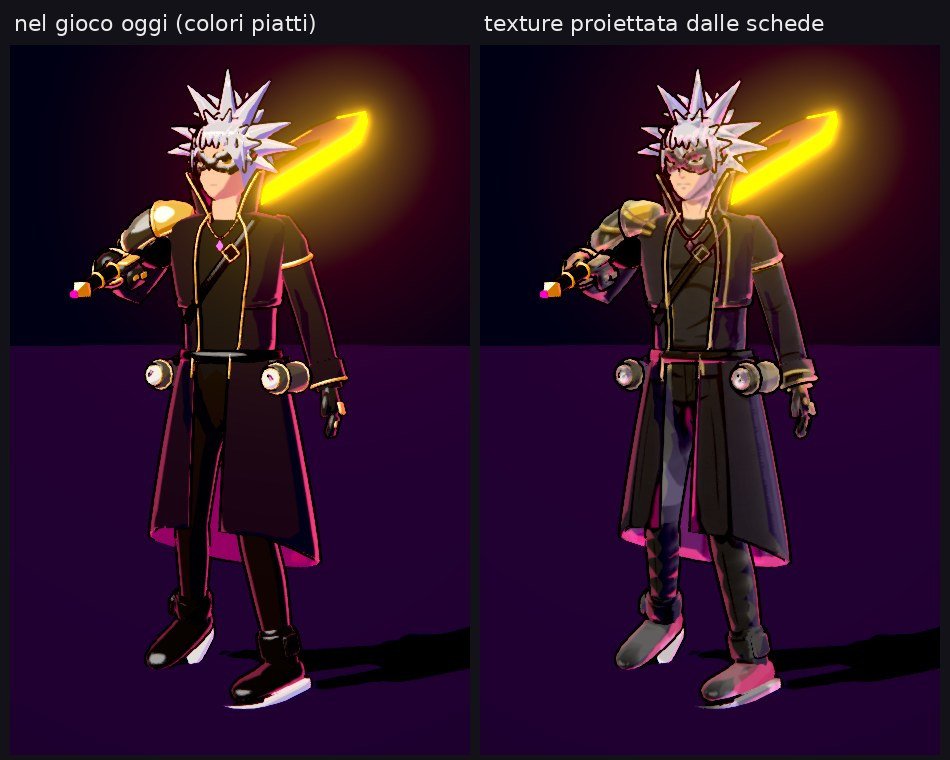

# Imitare Meshy: lo stadio "texture" con le schede Gemini

Meshy, come gli altri servizi immagine→3D, lavora a stadi. Prima la **geometria**, generata
da un modello neurale addestrato su milioni di oggetti 3D. Poi la **texture**: genera più
viste del personaggio, le proietta sulla mesh e riempie le zone che nessuna vista vede.
Infine remesh, rig e animazioni. La ricerca completa sta in `ricerca_meshy.md`.

La geometria non si imita senza quei modelli e senza una GPU. Lo stadio texture sì:
`tools/blender/project_sheets.py` lo rifà con le due viste che abbiamo già, le schede Gemini
di fronte e retro di Kaiser.

```bash
/root/blender-venv/bin/python tools/blender/project_sheets.py --out <cartella> --inpaint [--glb <file.glb>]
```

1. Importa `public/models/kaiser.glb` e lo mette nella posa A delle schede, con le stesse
   camere dei confronti di `build_kaiser.py`.
2. Rifà le UV (Smart UV Project) e calcola con un bake posizione e normale 3D di ogni texel.
3. Proietta ogni texel in ciascuna scheda. Lo tiene solo se è visibile (test di profondità)
   e dentro la sagoma, con peso maggiore se la superficie guarda dritta verso quella vista.
4. Con `--inpaint`, le zone che nessuna scheda vede prendono il colore delle superfici dipinte
   vicine in 3D (la versione semplice dell'inpainting dei servizi).
5. Salva la texture, i render delle viste delle schede e, a richiesta, un GLB con la
   texture.




## Risultato

- **Di fronte:** il modello è quasi identico alla scheda. Maschera, occhi, collana, cinghia,
  finiture e fodera arrivano dal disegno, non dalla modellazione.
- **Di 3/4 e di lato:** con due sole viste compaiono aloni e zone sbiadite (stivali,
  spallaccio). Meshy usa sei o più viste generate apposta. Con schede Gemini aggiuntive
  (lato e 3/4) qui si otterrebbe lo stesso effetto.
- **Nel gioco:** provato nel viewer (`?viewer&champ=kaiser`) sostituendo per un momento
  `public/models/kaiser.glb` con l'export `--glb`. Il modello si carica e si anima con lo
  stesso rig, perché `glbModels.ts` passa già la `map` al toon shader. Il look è più
  "disegnato", ma le ombre della scheda si sommano a quelle del toon e gli stivali escono
  slavati. Il GLB del gioco non è stato cambiato.



## La geometria: Meshy vero tramite API

Per la forma serve il generatore. `tools/meshy/` lo usa tramite l'API di Meshy (piano Pro, gli
stessi crediti del piano):
1. concept di Rex fronte e retro;
2. modello 3D in T-pose con texture;
3. `tools/blender/import_generated.py`, che trova lo scheletro dalla forma, calcola i pesi e lo
   porta nel gioco dietro `?rex=meshy`.

Istruzioni e limiti in `tools/meshy/README.md`. In attesa dell'accesso, l'importatore è stato
provato su un sostituto: il Rex scolpito fuso in un'unica superficie con una texture.


