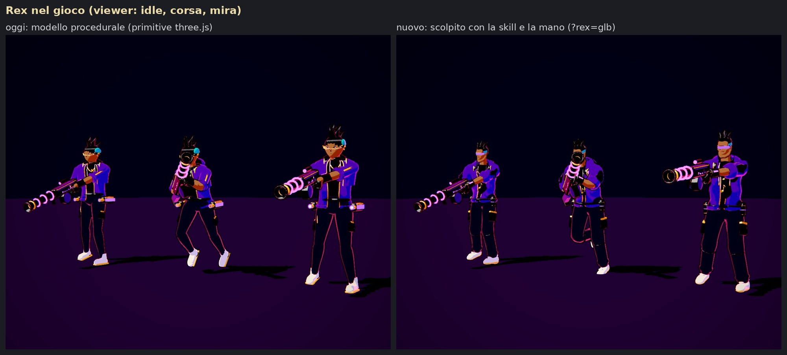
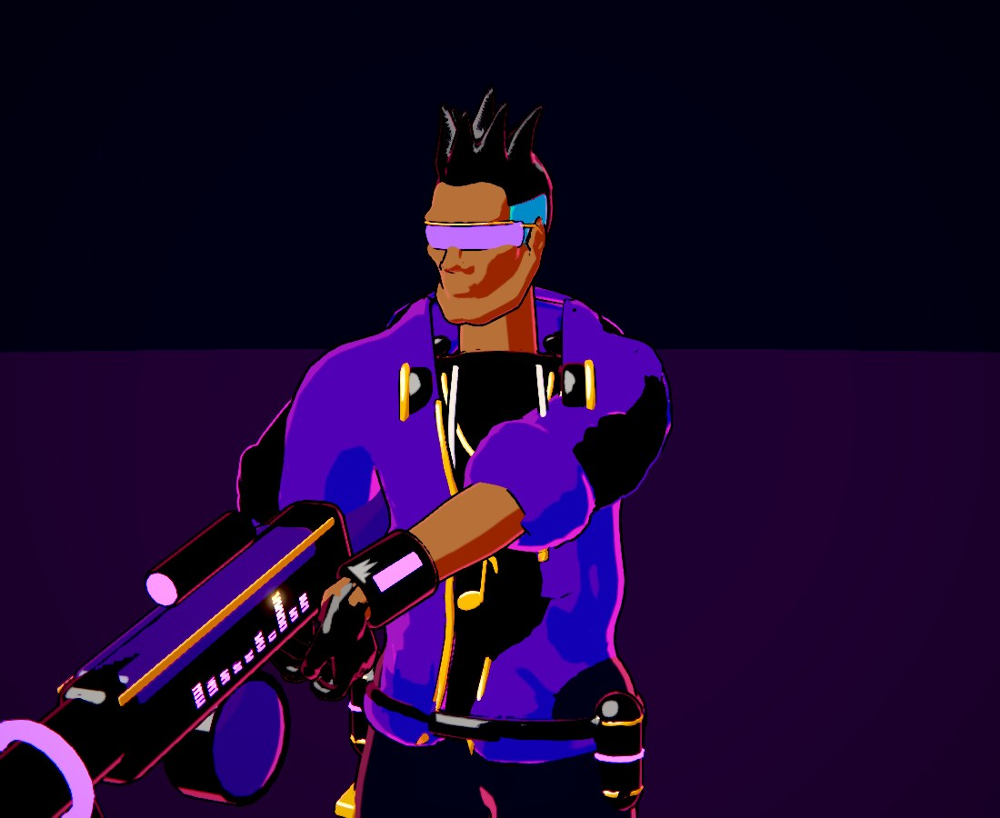
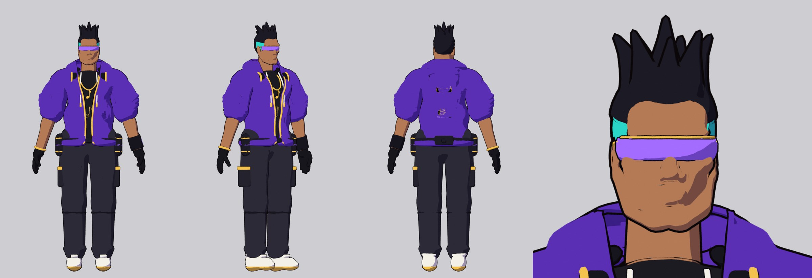
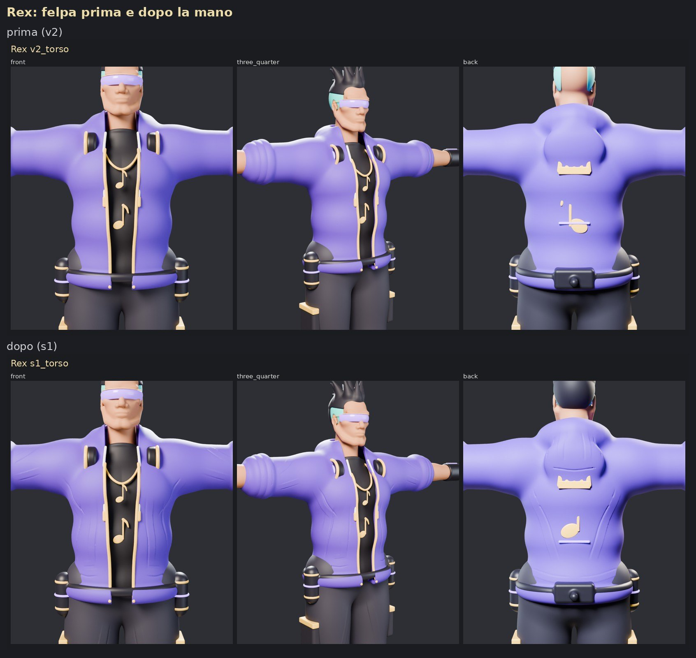
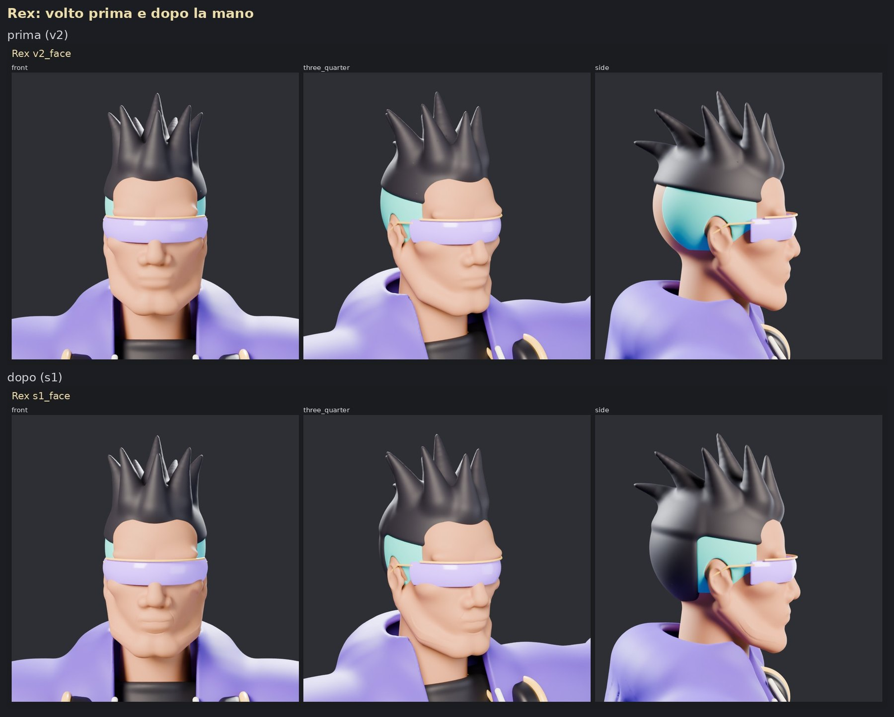

# Rex rifatto con la skill e la "mano"

Rex nel gioco è costruito in TypeScript con primitive three.js (`src/champions/rex.ts`). Qui
è stato rifatto come modello scolpito, con lo stesso metodo di Zugzwang:

1. **Forme in SDF** (`charkit/sdf.py`), 32 parti in T-pose sullo scheletro 'heavy' del
   gioco (`src/fighter/Rig.ts`):
   - testa con mascella, naso e orecchie;
   - capelli a punta e lati rasati verde acqua, occhiali olografici;
   - felpa oversize aperta con cappuccio raccolto e maniche spinte al gomito, maglietta con la
     nota, catena, cuffie al collo;
   - guanti, bracciale tecnico, cargo con tasche, sneaker, cintura con le bombole.
2. **Passata "mano"** (`charkit/sculpt.py`), 91 colpi tracciati su viste con griglia in mm:
   - felpa: pieghe che cadono dall'apertura, pieghe dall'ascella, arricciature in vita, pieghe
     a V sulla schiena, bordo e pieghe del cappuccio, solchi tra i rotoli delle maniche;
   - pantaloni: pieghe sul ginocchio e arricciature sopra le scarpe;
   - volto: linea della bocca e labbra, solco sotto il labbro, ali del naso, piano dello
     zigomo, linea della mascella.
3. **Rig ed export** come Kaiser (`bl_kit.py`):
   - le 19 ossa del gioco più dita e pollici, così il gioco chiude la presa sul fucile;
   - pesi automatici per parte;
   - decimazione a circa 44.000 triangoli;
   - colori piatti con i nomi dei materiali del modello procedurale;
   - export in `public/models/rex.glb`.

```bash
PY=/root/blender-venv/bin/python
$PY tools/blender/build_rex.py --out <cartella> --stage parts                          # forme SDF + render
$PY tools/blender/build_rex.py --out <cartella> --stage grid --part hoodie --gviews torso  # viste per i colpi
$PY tools/blender/build_rex.py --out <cartella> --stage sculpt                         # la mano
$PY tools/blender/build_rex.py --out <cartella> --stage export --glb public/models/rex.glb
```

## Nel gioco




Il nuovo Rex usa arma (HEADLINER), animazioni e socket del modello procedurale
(`src/champions/rexGlb.ts`). **È opzionale:** si attiva aggiungendo `?rex=glb` all'URL, per
esempio `http://localhost:5173/?rex=glb` per giocare o
`?viewer&champ=rex&anims=idle,run,aim&rex=glb` per il viewer. Senza il parametro il gioco
resta identico: il controllo pixel per pixel col modello procedurale dà differenza zero.

È opzionale perché un'altra sessione (branch `claude/sharp-ritchie-a620h8`) sta facendo un
passaggio completo sul Rex procedurale: molle su capelli, cuffie e cappuccio, rinculo del
fucile, effetti. Il modello GLB ha il corpo rigido sulle ossa, quindi perderebbe quelle molle.
L'arma di `rexGlb.ts` è inoltre la copia di quella procedurale di prima di quel lavoro. Per
farlo diventare il Rex di default basta spostare `rex` da `OPT_IN_PATHS` a `MODEL_PATHS` in
`src/champions/glbModels.ts`. Prima conviene unire i due lavori.

## Rex da Meshy (`?rex=meshy`)

Il modello scolpito non ha la geometria di un modello Meshy: per quella serve il generatore. Il
percorso con l'API di Meshy (concept, modello 3D, scheletro trovato dalla forma, pesi) è in
`tools/meshy/README.md`. Il risultato va in `public/models/generated/rex.glb` e si attiva con
`?rex=meshy`; finché il file non c'è, il parametro lascia il Rex procedurale. Usa la stessa arma,
le stesse animazioni e gli stessi socket di questa versione (`src/champions/rexGlb.ts`).

## Anteprima con lo shader toon



Render in Blender con materiali toon e contorni come nel gioco, braccia abbassate dal rig.
Serve a controllare pesi e deformazioni prima dell'export.

## La mano, prima e dopo




## Limiti

- **Molle:** i pezzi che nel modello procedurale oscillano (punte dei capelli, cuffie,
  cappuccio) qui sono rigidi. Si possono aggiungere come catene di ossa (`ggg_chains`,
  come le falde di Kaiser).
- **Occhi:** non sono modellati, li coprono gli occhiali.
- **Decimazione:** a 44.000 triangoli le pieghe fini si ammorbidiscono, e lo shader toon a due
  toni mostra soprattutto le pieghe grandi.
- **Peso:** il modello pesa il triplo di Kaiser (circa 15.500 triangoli). Per allinearsi si
  può scendere a 25.000–30.000 triangoli sui budget di `TRI_BUDGET`.
- **Silhouette:** più massiccia di quella procedurale (felpa oversize, cargo larghi, sneaker
  grosse). È fedele al brief di `docs/art/character-prompts.md`, ma diversa dal Rex attuale.
