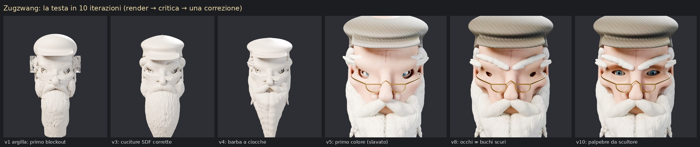
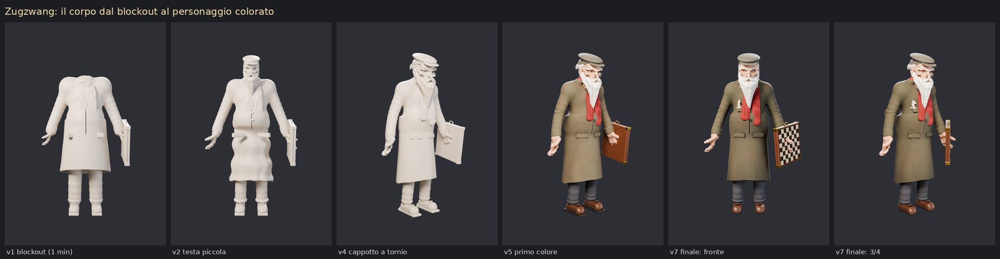
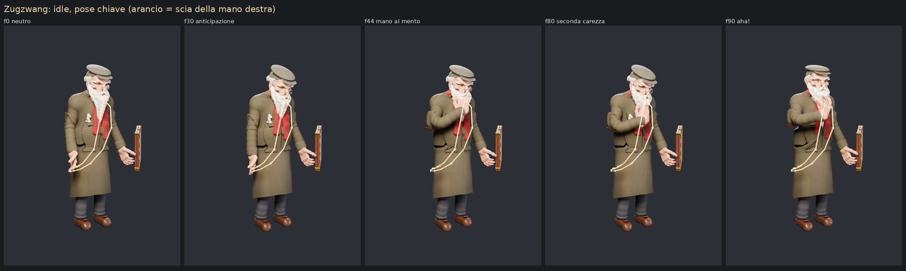
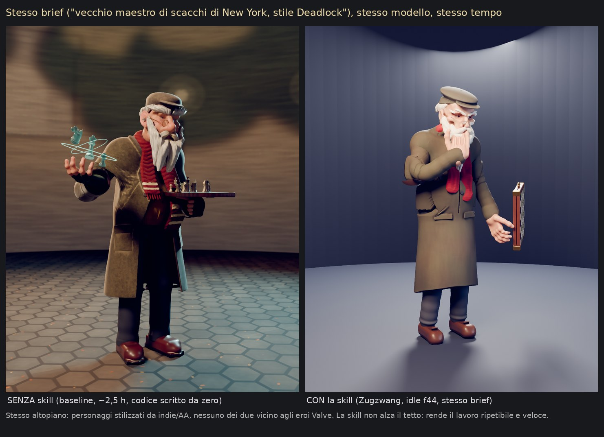

# Skill `blender-character`: personaggi 3D da codice, con metodo

La skill sta in `.claude/skills/blender-character/`. Si attiva da sola quando una sessione
deve creare, migliorare, riggare o animare un personaggio in Blender. Non "allena" il
modello: gli dà un metodo a fasi con controlli di qualità, un toolkit collaudato
(`scripts/charkit/`) e un personaggio completo d'esempio da cui copiare le tecniche.

## Cosa c'è dentro

| Parte | A cosa serve |
|---|---|
| `SKILL.md` | il flusso: brief → landmark → blockout → forme → primo piano del volto → colore → rig → animazione, con un "cancello" di revisione a ogni fase e le trappole già pagate |
| `charkit/sdf.py` | scultura a campi di distanza: fusioni morbide come la creta, scavi, gusci per i vestiti, tornio, nastri, ciocche di capelli, snap sulla superficie, ray-cast, marching cubes |
| `charkit/paint.py` | colore "dipinto" per vertice: occlusione con tinta calda, cavità e bordi, luce calda dall'alto e fredda dal basso, zone di colore della pelle, pennellate |
| `charkit/studio.py` | luci a tre punti scalate sul soggetto, viste di revisione (argilla/colore), fogli con riga di sagome nere, GIF |
| `charkit/rig.py` | armatura dai landmark, pesi per parte/regione, pose in assi mondo, IK a due ossa, easing (anticipazione, scatto, assestamento), molle per barba/sciarpa, scie del movimento |
| `scripts/new_character.py` | modello di partenza con i flag `--fast --clay --face --rebuild` |
| `references/` | design (sagoma, forme, colore, note di stile Deadlock/Arcane/anime), anatomia, ricette di scultura, materiali, rig e tabelle di timing, rubrica di critica, limiti e percorso ibrido |

## Il personaggio di prova: "Zugzwang"

Brief: un vecchio maestro di scacchi dei parchi di New York, caricaturale e pittorico,
ispirato all'archetipo di Solomon di Deadlock ma con design originale. Gobba a punto
interrogativo, coppola, cappotto lungo, sciarpa rossa come unico accento, mani grandi e
nodose, valigetta-scacchiera con angolari d'ottone, pezzi nel taschino, mezzi occhiali da
lettura.

Ogni immagine è un giro del ciclo render → critica → una correzione. Le lezioni di ogni giro
(cuciture del campo, palpebre, ciocche, cappotto a tornio, A-pose larga per il rig) sono
finite nella skill.

Idle di 4 secondi (`zugzwang_idle.gif`). Sposta il peso, guarda la scacchiera, anticipa il
gesto, porta la mano al mento con un arco, accarezza la barba due volte, ha un "aha!" e si
assesta con un leggero overshoot. Barba e sciarpa seguono su molle.

## Il confronto: con e senza skill, stesso brief

Un secondo agente ha lavorato sullo stesso brief **senza** la skill, per circa 2,5 ore,
scrivendo ~5.600 righe di codice da zero. È arrivato allo stesso altopiano: un personaggio
stilizzato da indie/AA. Ha trovato un paio di idee migliori, ora entrate nella skill: la
messa in scena da hero shot con filtro pittorico Kuwahara e i pezzi olografici in orbita, che
fanno leggere subito il "mago degli scacchi". Il terzo test, un agente nuovo con la skill su
un personaggio diverso, si è fermato a metà per il limite di sessione.

Conclusione: la skill non alza il tetto di qualità. Quello lo fissa il mezzo, cioè il codice.
Rende però il risultato ripetibile e veloce, coerente tra i personaggi, integrato col gioco,
e senza le trappole già pagate.

## Onestà sul livello

- **Raggiunto:** un personaggio stilizzato coerente e leggibile, di livello indie/AA. Sagoma
  chiara, volto con espressione, materiali dipinti, rig con catene secondarie, un idle con
  anticipazione, archi, easing e follow-through.
- **Non raggiunto:** il livello degli eroi Valve (Solomon & co.). Lì lavorano concept artist,
  scultori in ZBrush, texture artist e animatori per mesi. Dal codice restano sotto volti e
  bocche, pieghe dei tessuti, mani e le sfumature del timing animato.
- **Per salire di livello:** il percorso ibrido (`references/hybrid.md`). Concept con Gemini,
  mesh dettagliata da un servizio immagine→3D (Tripo, Meshy, Rodin, Hunyuan3D) caricata nel
  repo, poi pulizia, rig, animazione e integrazione nel gioco fatte da Claude con questa skill.
