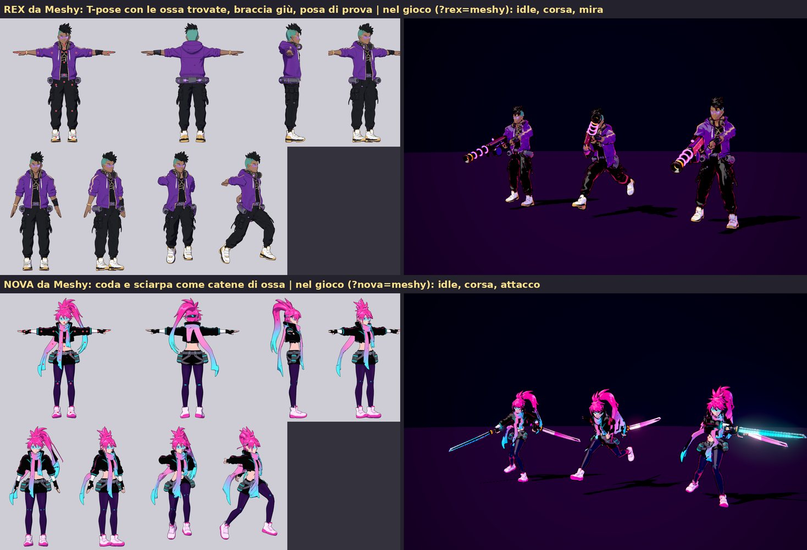
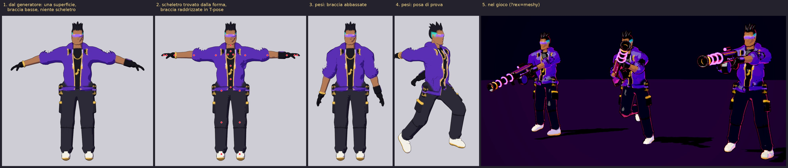

# Rex da Meshy

La forma di un modello Meshy non si ottiene da codice: viene da un generatore 3D addestrato.
Questa cartella fa generare il modello a Meshy tramite API e lo porta nel gioco in automatico.
Il risultato si vede con `?rex=meshy`. Rex procedurale (default) e Rex scolpito (`?rex=glb`)
restano come sono.

```
scheda (briefs/rex.json)
  → concept fronte e retro          Meshy image-to-image (nano-banana-pro)
  → modello 3D texturizzato         Meshy multi-image-to-3d, T-pose, ~30.000 triangoli
  → scheletro, pesi, GLB del gioco  tools/blender/import_generated.py
  → public/models/generated/rex.glb → ?rex=meshy
```

## Da fare una volta

1. **Piano Meshy Pro.** L'API consuma i crediti del piano (1.000 al mese), senza costi extra.
2. **Rete dell'ambiente.** Nelle impostazioni dell'ambiente cloud (menu dell'ambiente nella
   barra del titolo della sessione, poi Edit), in Network access, aggiungi agli Allowed domains:
   - `api.meshy.ai` (le richieste);
   - `assets.meshy.ai` (da qui si scaricano modelli e immagini).

   Lascia spuntata la casella dei package manager. I passaggi sono in
   <https://code.claude.com/docs/en/cloud-environments#network-access>.
3. **Chiave.** Nelle stesse impostazioni, aggiungila come variabile d'ambiente `MESHY_API_KEY`,
   oppure come network secret per `api.meshy.ai` dove la sezione c'è. La legge una sessione
   nuova. Non va mai scritta in un file del repository né incollata in chat.

## Generare Rex

```bash
python3 tools/meshy/meshy.py balance          # crediti rimasti
python3 tools/meshy/meshy.py concept rex      # scheda fronte e retro: circa 18 crediti
python3 tools/meshy/meshy.py model rex        # modello 3D: circa 30 crediti
PY=/root/blender-venv/bin/python
$PY tools/blender/import_generated.py --brief rex   # → public/models/generated/rex.glb
npm run dev                                    # poi http://localhost:5173/?rex=meshy
```

- **Costo.** Un tentativo completo costa circa 48 crediti, cioè 1 $ col piano Pro; tre
  tentativi circa 150. Il rig di Meshy (`meshy.py rig rex`, 5 crediti) è facoltativo:
  l'importatore usa il suo scheletro.
- **Lavori registrati.** Ogni passo è annotato in `jobs/<nome>/job.json`: richiesta, id del task,
  stato e file scaricati.
  - Un passo finito non viene rimandato (per rifarlo serve `--again`).
  - Un passo interrotto riprende dallo stesso task, con `status` o rilanciando il comando.
  - Meshy tiene i file solo 3 giorni, quindi il client li scarica subito. Le cartelle `jobs/`
    vanno nel repository.
- **Prova del flusso senza crediti.** `--test` usa la chiave di prova pubblica di Meshy, che
  restituisce sempre gli stessi risultati di esempio.
- **Solo controllo.** `--dry-run` mostra le richieste senza mandarle.
- **Concept propri.** Per esempio fatti con Gemini come in `docs/art/character-prompts.md`:
  `python3 tools/meshy/meshy.py model rex --images docs/art/sheets/rex_front.png docs/art/sheets/rex_back.png`.

Prompt, riferimenti e parametri stanno in `briefs/rex.json`:
- i prompt sono quelli di `docs/art/character-prompts.md`, con i render del gioco come riferimento;
- il modello è in T-pose, con remesh di Meshy a 30.000 triangoli (la texture viene cotta sulla
  mesh finale), senza luce cotta nei colori e senza "migliorare" lo stile anime;
- la sezione `import` dà l'altezza (1,87 m dalla suola alla punta dei capelli) e la corporatura
  'heavy' del Rex procedurale.

Le chiavi che iniziano con `_` sono note e non vengono inviate. Una stringa `"@percorso"` è
un'immagine locale; `"@concept:front"` è l'immagine generata da quello scatto.

## Modelli fatti nell'app web di Meshy

Un GLB scaricato dall'app web di Meshy entra nel gioco allo stesso modo, senza passare
dall'API. La scheda dà altezza, corporatura, budget di triangoli e catene:

```bash
PY=/root/blender-venv/bin/python
$PY tools/blender/import_generated.py Meshy_AI_Purple_Beat_Vanguard_texture.glb --brief rex --render <cartella>
$PY tools/blender/import_generated.py Meshy_AI_Neon_Pulse_Warrior_texture.glb --brief nova --render <cartella>
```

Il risultato va in `public/models/generated/<id>.glb` e si vede con `?rex=meshy` e `?nova=meshy`.
I due modelli attuali sono fatti così: gli originali (650–730 mila triangoli, texture 2048) restano
fuori dal repository e vengono ridotti a 40.000 triangoli.



### Catene: coda di cavallo, sciarpe, falde

Una parte lunga che pende va dichiarata nella scheda (`import.chains`, esempio in
`briefs/nova.json`), altrimenti i pesi automatici la incollano a cosce e braccia:

- `path`: la linea della catena nel modello inquadrato, in metri, con X a sinistra del
  personaggio, Y verso la schiena e Z in alto. Si misura sulle viste con la griglia.
- `radius`: quanto lontano dalla linea prendere i vertici.
- `hues`: i colori della texture che appartengono alla catena, per non prendere il corpo che sta
  vicino.
- `parent`: l'osso a cui è appesa.
- `bones`: quante ossa ha.
- `dynamics`: le molle nel gioco (`stiffness`, `falloff`, `damping`, `gravity`).

La catena deve partire dove la stoffa o i capelli si staccano dal corpo. Il tratto appoggiato su
schiena o petto resta rigido: dentro le sfere di collisione del gioco una catena verrebbe spinta
fuori e la stoffa si stirerebbe ad ala. Le catene vengono escluse dalla ricerca dello scheletro;
le loro ossa seguono la linea centrale dei vertici, e il peso passa dall'osso padre alla catena
nei primi 8 cm.

## Cosa fa l'importatore

`tools/blender/import_generated.py` prende il GLB di Meshy così com'è (forma e texture) e
aggiunge quello che serve al gioco:

1. **Inquadratura.** Mette l'apertura delle braccia lungo X e lo sguardo verso -Y: le punte dei
   piedi distinguono il davanti dal dietro. Poi scala all'altezza della scheda, con i piedi a
   terra.
2. **Scheletro dalla forma** (`tools/blender/rig_fit.py`), dalla sagoma frontale e dalla
   profondità del corpo:
   - cavallo, caviglie (dove il piede si stringe nello stinco) e ginocchia;
   - ascelle, linea mediana delle braccia, nocche e polsi;
   - colonna, collo e testa con le proporzioni del Rig.

   Dettagli:
   - **Braccio:** viene seguito colonna per colonna dalla mano verso il busto, in una fetta
     di profondità attorno alle mani, così ciocche sopra e capelli dietro non contano.
   - **Ascella:** sta dove il bordo inferiore cade sul busto o scende di un gradino netto,
     per esempio l'orlo di una giacca corta.
   - **Polso:** a una lunghezza di dita dalle nocche, nel punto più stretto. Le nocche sono il
     calo di spessore dal palmo alle dita.
   - **Braccio che pende:** viene rimisurato dopo averlo ruotato in orizzontale.
   - **Palmo:** si riconosce dal lato del pollice.
3. **T-pose.** Se le braccia pendono, i gomiti o le gambe sono piegati, o i palmi non guardano
   in basso, un rig provvisorio raddrizza il modello come i GLB del gioco: braccia lungo X,
   gambe verticali, palmi in giù.
4. **Ossa sulla formula del Rig** per le proporzioni misurate (al massimo 3 cm dalle
   articolazioni misurate). Così Rig pilota e modello coincidono e il fucile resta nel pugno.
5. **Pesi automatici di Blender** (bone heat), calcolati su una copia rifatta a voxel.
   - La copia è sempre chiusa, anche quando la superficie del generatore non lo è.
   - I pesi vengono poi copiati sulla mesh vera, con al massimo 4 ossa per vertice.
   - Se un osso resta senza pesi, l'importatore lo segnala.
6. **Export.**
   - Ossa del gioco e dita.
   - Negli extras: `ggg_spec` (proporzioni per il Rig pilota), socket del rampino e
     `ggg_source` (task di Meshy da cui viene).
   - La texture viene ridotta a una JPEG di 2048 px al massimo.
   - Un foglio di controllo va in `jobs/<nome>/import/`: T-pose con le articolazioni, braccia
     giù, posa di prova.

### Prova senza Meshy

Non avendo ancora accesso a Meshy, l'importatore è stato provato su **sostituti**
(`tools/blender/standin_generated.py`). Il sostituto parte dal Rex scolpito, messo in posa e
fuso in un'unica superficie con remesh a voxel, decimato a 30.000 triangoli e con i colori cotti
in una sola texture. È la stessa forma di un output Meshy: superficie unica, maniche fuse alle
braccia, mani a muffola, nessuno scheletro.

Prove fatte:
- quattro pose: T-pose, braccia basse di 12°, A-pose a 40° con gomiti piegati, palmi in avanti;
- errore sulle articolazioni rispetto allo scheletro vero del sostituto: al massimo 4,2 cm,
  mani e gomiti entro 1 cm;
- nel gioco: idle, corsa e mira col fucile nelle mani.



Il sostituto **non** è un modello Meshy e non è nel repository come tale. I modelli veri di Rex
e Nova, fatti nell'app web, sono quelli dell'immagine qui sopra.

## Limiti

- **Pesi automatici.** Dove la manica arrotolata sta sul gomito, nelle pieghe forti i rotoli si
  compenetrano. Va rivisto sul modello vero.
- **Niente molle.** Ciuffi, cappuccio e cuffie sono rigidi. Le catene (`ggg_chains`) si possono
  aggiungere come per Kaiser e per la coda di Nova.
- **Proporzioni diverse.** Lo scheletro misurato può avere braccia più corte o più lunghe del
  modello procedurale. Il fucile di Rex segue il braccio: le pose in spalla sono calcolate sulle
  proporzioni del modello e il calcio si accorcia o allunga in proporzione (`stockZFor` in
  `src/champions/rex.ts`). Per un altro campione con un'arma da spalla serve la stessa cosa.
- **A-pose marcata.** Quando si raddrizzano le braccia, la stoffa sotto l'ascella si stira in
  alette. Per questo la scheda chiede la T-pose.
- **Rig di Meshy.** Se gli si passa il GLB riggato da Meshy, l'importatore ne usa la posa di
  legame ma rifà scheletro e pesi.
- **Licenza.** Col piano Pro i modelli sono privati e a uso commerciale. Col piano Free sono
  CC BY 4.0 (ricerca in `docs/art/meshy/ricerca_meshy.md`).
